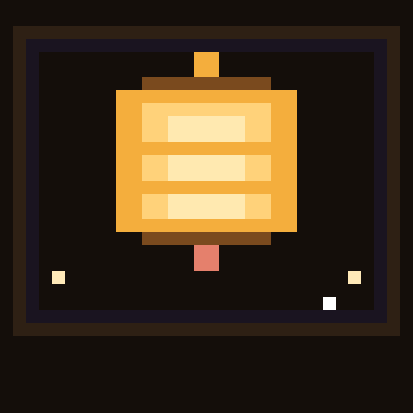
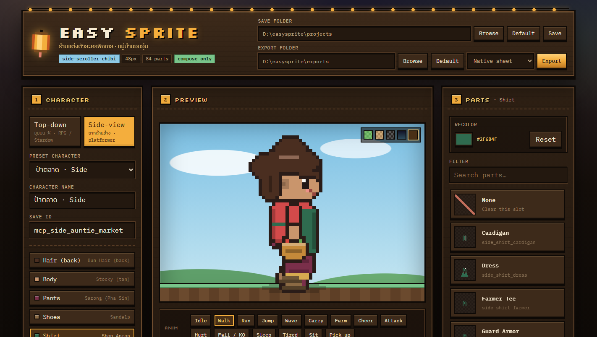
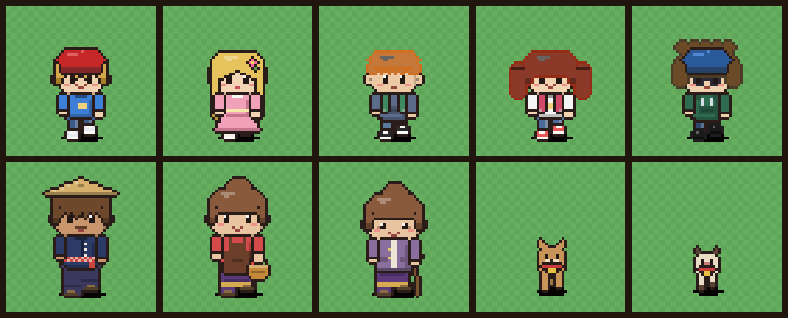
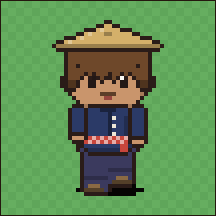
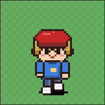
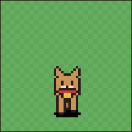
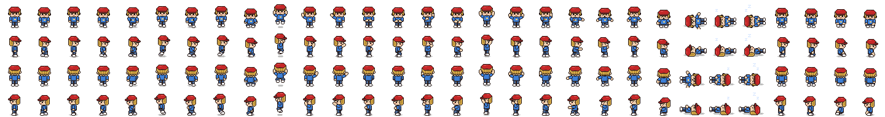
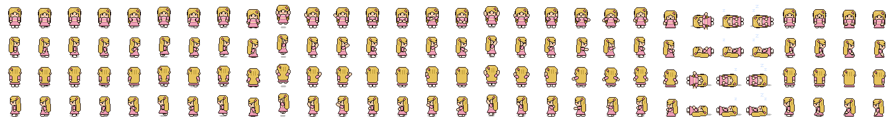
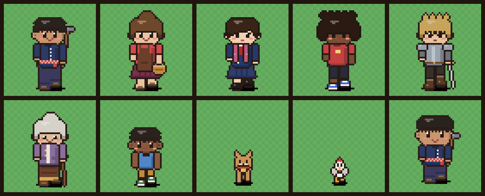
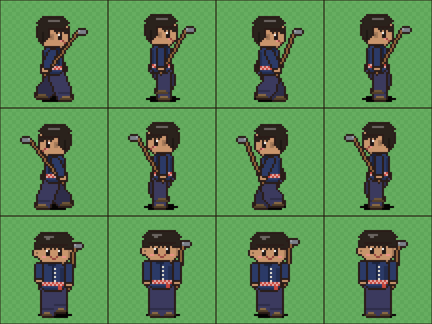

<p align="center">
  
</p>

# Easy Sprite

**ร้านแต่งตัวละครพิกเซล · หมู่บ้านอบอุ่น**  
Compose modular **48px** chibi sprites for a Thai cozy-village game — **top-down ¾** (RPG Maker / Stardew) or **side-view** (side-scroller / HD-2D village scenes).

[](https://github.com/Saladin2020/easysprite/actions/workflows/ci.yml)
[](LICENSE)
[](https://nodejs.org)
[](#desktop)
[](#ios--ipados)
[](docs/MCP.md)

> You prep the art. Easy Sprite only **selects · recolors · previews · exports**.  
> No AI art generation in-app.

<p align="center">
  
</p>

<p align="center">
  
</p>

---

## Why it exists

Dress a whole village cast without redrawing every sheet: bodies, clothes, hair, faces, accessories, pets, and wild animals — stacked as a paperdoll on a locked 30-frame grid.

| Humans | Pets | Wild |
| --- | --- | --- |
| adult · child · elder · stocky | dog cat rabbit chicken duck buffalo pig | deer boar tiger elephant monkey squirrel myna |

<p align="center">
  
  
  
</p>

Native top-down export sheets (4 directions × 30 frames):

<p align="center">
  
  
</p>

---

## Two cameras: top-down / side-view

Flip **Top-down ↔ Side-view** in panel 1 and the outfit carries over. Every top-down part has a side-view twin with taller proportions and a lower ground line.

| | Top-down | Side-view |
| --- | --- | --- |
| Use for | RPG Maker, Stardew-style maps | platformers, side-scrolling village scenes |
| Rows | `front right back left` | `right left front` |
| Part ids | `shirt_mohom` | `side_shirt_mohom` |
| Exports | native · RPG Maker · Godot · frames | native · Godot · frames |

<p align="center">
  
</p>
<p align="center">
  
</p>

Projects store `"view": "side"`. MCP agents pass `view` to `list_parts` / `compose_character`. Ids from the wrong camera are swapped to their twin automatically.

---

## Quick start

```bash
git clone https://github.com/Saladin2020/easysprite.git
cd easysprite
npm install
npm run init          # sample parts + demo projects (first run)
npm run desktop       # open the UI in your browser
```

Dev mode (API + Vite):

```bash
npm run dev
# API  http://127.0.0.1:8787
# UI   http://127.0.0.1:5173
```

Optional reference packs:

```bash
npm run vendor:fetch
```

---

## Desktop

One command starts the local server and opens the UI. Close the terminal to stop.

| OS | Launcher |
| --- | --- |
| **Windows** | `npm run desktop:shortcut` → Desktop `Easy Sprite.lnk` · or `scripts\start-desktop.bat` |
| **macOS** | `npm run desktop:shortcut` → Desktop `Easy Sprite.command` · or `scripts/start-desktop.sh` |
| **Linux** | `npm run desktop:shortcut` → Desktop `.desktop` + apps menu · or `scripts/start-desktop.sh` |

```bash
npm run desktop              # start + open browser
npm run desktop:shortcut     # install/update Desktop icon only
```

Workspace defaults to `EASYSPRITE_HOME` if set, otherwise the repo folder.

### Security

The API is local-only by design:

- No CORS. Requests that change anything must come from the Easy Sprite UI itself (same origin), so other websites cannot write files.
- On `127.0.0.1` (default) only loopback `Host` headers are accepted. On any other host (e.g. `0.0.0.0`) **every request needs the token** printed at startup (`?token=`, cookie, or `x-easysprite-token` header).
- Projects and exports are written only inside the workspace, folders you pick with **Browse**, or folders listed in `EASYSPRITE_ALLOWED_DIRS` (OS path separator). Picked folders are remembered in `easysprite.allowed-dirs.json`.
- Project ids are limited to `a-z 0-9 _ -`. `/api/export` writes only `.png` (real PNG data) and `.json` files.

### iOS / iPadOS

There is no App Store binary — the **web UI is the app**:

1. Run Easy Sprite on a machine on your network (`npm run desktop -- --host 0.0.0.0`)
2. The terminal prints a **token** (set `EASYSPRITE_TOKEN` to keep it fixed). Open `http://<machine-ip>:8787/?token=<token>` in **Safari** on iPhone/iPad
3. Share → **Add to Home Screen** (PWA: icon, standalone chrome, theme color). If the home-screen app asks for the token, paste it once

Favicon + Apple touch icon + `site.webmanifest` ship in `web/public/`.

---

## Features

- Slot paperdoll: `hair_back → body → pants → shoes → shirt → face → hair_front → accessory`
- Recolor with hue-aware shading (hair front/back sync)
- Two cameras: top-down ¾ (4 directions) and side-view (right / left / front), one switch
- Timeline preview: walk / wave / cheer / … with a side-scroller sky + ground backdrop
- Save / export to **any folder** (Browse + remember last paths)
- Animated **showcase** gallery (HTML) with direction + anim controls
- **MCP** tools for Cursor / HTTP agents — compose & export without clicking ([docs/MCP.md](docs/MCP.md))
- Export presets: native · RPG Maker MV/MZ · Godot atlas · frame folder

Art-style lock: see [`docs/STYLE.md`](docs/STYLE.md) · [`vendor/REFERENCES.md`](vendor/REFERENCES.md)

---

## Commands

```bash
npm run init
npm run serve
npm run desktop
npm run desktop:shortcut
npm run build
npm run mcp              # stdio MCP
npm run mcp:http         # http://127.0.0.1:8790/mcp
npm run mcp:install-launcher   # copy the MCP launcher to ~/.cursor/easysprite-mcp.mjs
npx tsx src/cli.ts showcase --open
npm run typecheck
npm test                 # vitest unit tests
npm run smoke            # MCP smoke tests (run npm run init first)
```

`npm run init` creates sample parts when `parts/` is empty and seeds demo characters when `projects/` has none. `npx tsx src/cli.ts init --force-samples` regenerates both.

---

## Part format

```text
parts/<slot>/<part_id>/
  sheet.png
  part.json
```

30 columns = frame list · one row per entry in `directions` (top-down `front right back left`, side-view `right left front`).  
Side-view parts set `"view": "side"` and use a `side_` id prefix.  
Wearables that fit several builds list `bodyTypes` and stack one block per build.  
Animals are full bodies: `animal_<species>`. Human clothes skip animals unless `bodyTypes` includes that species (`acc_pet_collar`).

---

## MCP (agents)

Compose-only operator flow: `workspace_info → list_parts → compose_character → export_character`.  
Never invent part ids. Prompt: `easysprite-operator`. Details: [`docs/MCP.md`](docs/MCP.md).

---

## License / credit

Easy Sprite's code is released under the [MIT License](LICENSE) © 2026 Salahuddin Benno. The MIT license covers the code only; it does not relicense any third-party art.

Sample art is generated by the local sample pipeline for demos. Third-party vendor packs are **not** vendored in git — fetch them yourself and respect each pack’s license (`npm run vendor:fetch`). LPC layers are CC0 / CC-BY / CC-BY-SA / OGA-BY / GPL per layer and need credits — see [`vendor/REFERENCES.md`](vendor/REFERENCES.md).

---

<p align="center">
  <sub>teak · lanterns · 48px dreams</sub>
</p>
