<!-- easy-suite:header:start -->
<p align="center">
  <a href="#easy-suite">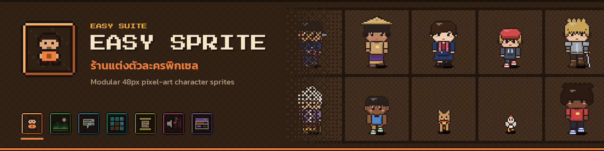</a>
</p>

<p align="center">
  <b>Easy Sprite</b> · ร้านแต่งตัวละครพิกเซล · Modular 48px pixel-art character sprites<br />
  <sub>Part of <a href="#easy-suite"><b>Easy Suite</b></a>: Thai-friendly pixel-art game dev tools for Godot 4.3+ and PixiJS v8</sub>
</p>

<p align="center">
  <a href="https://github.com/Saladin2020/easysprite/actions/workflows/ci.yml"></a> <a href="LICENSE"></a>  <a href="https://github.com/Saladin2020/easyscene"></a> <a href="docs/MCP.md"></a> 
</p>

<p align="center">
  <a href="https://github.com/Saladin2020/easysprite">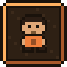</a>
  <a href="https://github.com/Saladin2020/easyscene">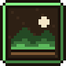</a>
  <a href="https://github.com/Saladin2020/easydialogue"></a>
  <a href="https://github.com/Saladin2020/easytilemap">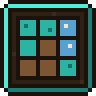</a>
  <a href="https://github.com/Saladin2020/easyquest"></a>
  <a href="https://github.com/Saladin2020/easysfx"></a>
  <a href="https://github.com/Saladin2020/easyui">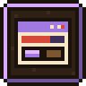</a>
</p>
<!-- easy-suite:header:end -->

# Easy Sprite

**ร้านแต่งตัวละครพิกเซล · หมู่บ้านอบอุ่น**  
Compose modular **48px** chibi sprites for a Thai cozy-village game — **top-down ¾** (RPG Maker / Stardew) or **side-view** (side-scroller / HD-2D village scenes).

[](https://nodejs.org)
[](#desktop)
[](#ios--ipados)

> You prep the art. Easy Sprite only **selects · recolors · previews · exports**.  
> No AI art generation in-app.

<p align="center">
  
</p>

<p align="center">
  
</p>

---

## Why it exists

Dress a whole village cast without redrawing every sheet: bodies, clothes, hair, faces, accessories, pets, and wild animals — stacked as a paperdoll on a locked 30-frame grid.

| Humans | Pets | Wild |
| --- | --- | --- |
| adult · child · elder · stocky | dog cat rabbit chicken duck buffalo pig | deer boar tiger elephant monkey squirrel myna |

<p align="center">
  
  
  
  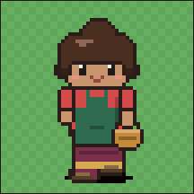
  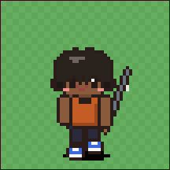
</p>

Thai temple set — `shirt_monk_robe` (จีวร: saffron, over the left shoulder, right shoulder bare, hangs to the shins), `pants_sabong` (สบง lower robe) and `hair_shaved_front` (translucent stubble cap that works on any skin tone), in both cameras (`side_` twins):

<p align="center">
  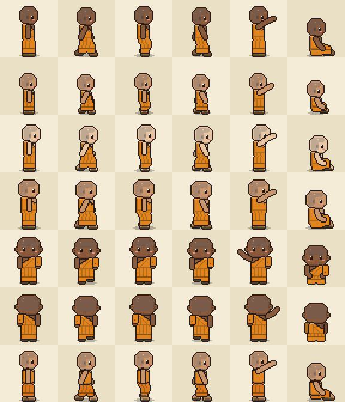
</p>

### Multicultural village: Buddhist · Muslim · Chinese-Thai

The village is shared by neighbours of every faith, so the library dresses all of them. Next to the temple set there is a **Muslim community (ชุมชนมุสลิม) set** for southern Thai / Thai-Malay kampung casts (Pattani, Satun, Bangkok), in both cameras:

| Part | ไทย | Notes |
| --- | --- | --- |
| `hair_hijab_front` · `hair_hijab_shawl_front` | ฮิญาบ | wrap and pashmina styles; frame the face, cover hair, ears and neck in every direction, drape over the chest |
| `hair_tudung_sarung_front` | ผ้าคลุมสวม (tudung sarung) | slip-on tudung with the stiff forehead awning |
| `hair_tudung_school_front` | ผ้าคลุมนักเรียนตาดีกา | long white school tudung for Tadika girls |
| `acc_kopiah` · `acc_songkok` | กะปิเยาะห์ · ซอเกาะ | white knitted cap and black velvet cap (accessory slot, like `acc_cap`) |
| `shirt_jubah` | ญุบบะฮ์ / thobe | ankle-length robe, no pants needed |
| `shirt_baju_melayu` | บาจูมลายู | cekak musang collar, gold buttons and a songket samping |
| `shirt_baju_kurung` | บาจูกูรง | knee-length tunic; pair with `pants_sarong` or `pants_skirt` |
| `pants_kain_pelekat` | ผ้าโสร่งตาหมากรุก | checked men's sarong with a rolled waist |

All of them recolor. Hijab and tudung live in `hair_front`; leave `hair_back` empty. New demo characters: `hijab_teacher`, `roti_seller`, `mak_yah`, `tadika_girl`, `kopiah_boy`, `songkok_groom`, `pak_cik_jubah`, `pelekat_fisher` (plus `side_` versions of four).

<p align="center">
  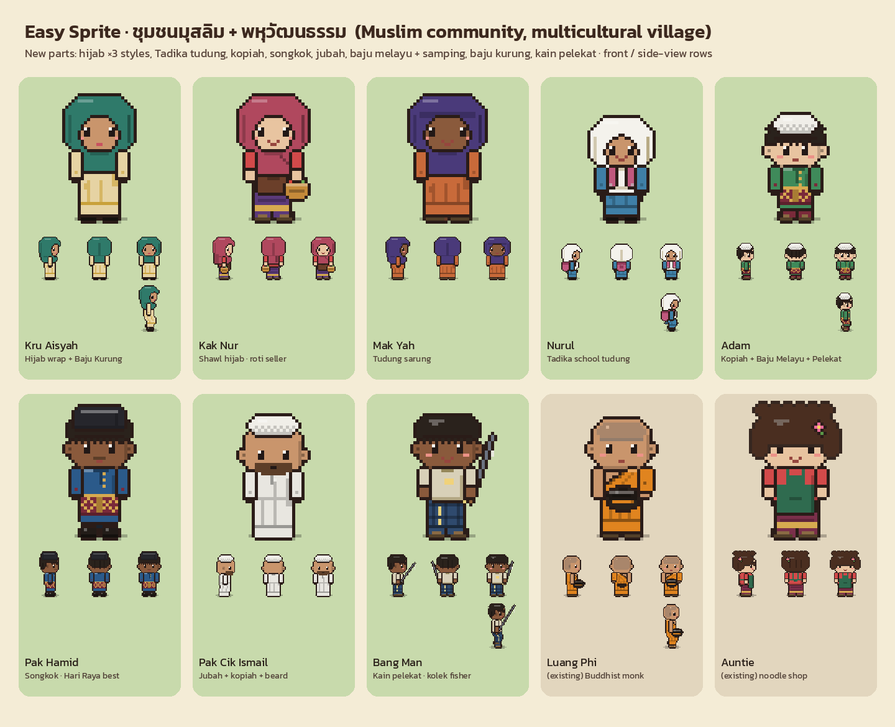
</p>

Native top-down export sheets (4 directions × 30 frames):

<p align="center">
  
  
</p>

Native side-view export sheets (3 directions × 30 frames) — composed via MCP:

<p align="center">
  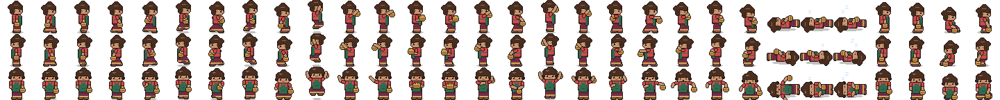
  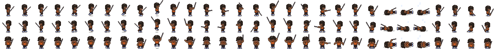
</p>

---

## Two cameras: top-down / side-view

Flip **Top-down ↔ Side-view** in panel 1 and the outfit carries over. Every top-down part has a side-view twin with taller proportions and a lower ground line.

| | Top-down | Side-view |
| --- | --- | --- |
| Use for | RPG Maker, Stardew-style maps | platformers, side-scrolling village scenes |
| Rows | `front right back left` | `right left front` |
| Part ids | `shirt_mohom` | `side_shirt_mohom` |
| Exports | native · RPG Maker · Godot · frames | native · Godot · frames |

<p align="center">
  
</p>
<p align="center">
  
</p>

Projects store `"view": "side"`. MCP agents pass `view` to `list_parts` / `compose_character`. Ids from the wrong camera are swapped to their twin automatically.

---

## Quick start

```bash
git clone https://github.com/Saladin2020/easysprite.git
cd easysprite
npm install
npm run init          # sample parts + demo projects (first run)
npm run desktop       # open the UI in your browser
```

Dev mode (API + Vite):

```bash
npm run dev
# API  http://127.0.0.1:8787
# UI   http://127.0.0.1:5173
```

Optional reference packs:

```bash
npm run vendor:fetch
```

---

## Desktop

One command starts the local server and opens the UI. Close the terminal to stop.

| OS | Launcher |
| --- | --- |
| **Windows** | `npm run desktop:shortcut` → Desktop `Easy Sprite.lnk` · or `scripts\start-desktop.bat` |
| **macOS** | `npm run desktop:shortcut` → Desktop `Easy Sprite.command` · or `scripts/start-desktop.sh` |
| **Linux** | `npm run desktop:shortcut` → Desktop `.desktop` + apps menu · or `scripts/start-desktop.sh` |

```bash
npm run desktop              # start + open browser
npm run desktop:shortcut     # install/update Desktop icon only
```

Workspace defaults to `EASYSPRITE_HOME` if set, otherwise the repo folder.

### Security

The API is local-only by design:

- No CORS. Requests that change anything must come from the Easy Sprite UI itself (same origin), so other websites cannot write files.
- On `127.0.0.1` (default) only loopback `Host` headers are accepted. On any other host (e.g. `0.0.0.0`) **every request needs the token** printed at startup (`?token=`, cookie, or `x-easysprite-token` header).
- Projects and exports are written only inside the workspace, folders you pick with **Browse**, or folders listed in `EASYSPRITE_ALLOWED_DIRS` (OS path separator). Picked folders are remembered in `easysprite.allowed-dirs.json`.
- Project ids are limited to `a-z 0-9 _ -`. `/api/export` writes only `.png` (real PNG data) and `.json` files.

### iOS / iPadOS

There is no App Store binary — the **web UI is the app**:

1. Run Easy Sprite on a machine on your network (`npm run desktop -- --host 0.0.0.0`)
2. The terminal prints a **token** (set `EASYSPRITE_TOKEN` to keep it fixed). Open `http://<machine-ip>:8787/?token=<token>` in **Safari** on iPhone/iPad
3. Share → **Add to Home Screen** (PWA: icon, standalone chrome, theme color). If the home-screen app asks for the token, paste it once

Favicon + Apple touch icon + `site.webmanifest` ship in `web/public/`.

---

## Features

- Slot paperdoll: `hair_back → body → pants → shoes → shirt → face → hair_front → accessory`
- Recolor with hue-aware shading (hair front/back sync)
- Two cameras: top-down ¾ (4 directions) and side-view (right / left / front), one switch
- Timeline preview: walk / wave / cheer / … with a side-scroller sky + ground backdrop
- Save / export to **any folder** (Browse + remember last paths)
- Animated **showcase** gallery (HTML) with direction + anim controls
- **MCP** tools for Cursor / HTTP agents — compose & export without clicking ([docs/MCP.md](docs/MCP.md))
- Export presets: native · RPG Maker MV/MZ · Godot atlas · frame folder

Art-style lock: see [`docs/STYLE.md`](docs/STYLE.md) · [`vendor/REFERENCES.md`](vendor/REFERENCES.md)

---

## Commands

```bash
npm run init
npm run serve
npm run desktop
npm run desktop:shortcut
npm run build
npm run mcp              # stdio MCP
npm run mcp:http         # http://127.0.0.1:8790/mcp
npm run mcp:install-launcher   # copy the MCP launcher to ~/.cursor/easysprite-mcp.mjs
npx tsx src/cli.ts showcase --open
npm run typecheck
npm test                 # vitest unit tests
npm run smoke            # MCP smoke tests (run npm run init first)
```

`npm run init` creates sample parts when `parts/` is empty and seeds demo characters when `projects/` has none. `npx tsx src/cli.ts init --force-samples` regenerates both.

---

## Part format

```text
parts/<slot>/<part_id>/
  sheet.png
  part.json
```

30 columns = frame list · one row per entry in `directions` (top-down `front right back left`, side-view `right left front`).  
Side-view parts set `"view": "side"` and use a `side_` id prefix.  
Wearables that fit several builds list `bodyTypes` and stack one block per build.  
Animals are full bodies: `animal_<species>`. Human clothes skip animals unless `bodyTypes` includes that species (`acc_pet_collar`).  
Sample library: 101 parts per camera (202 total). Full-length outfits such as `shirt_monk_robe` and `shirt_jubah` live in the `shirt` slot (z 40, above pants), so they cover the legs without a pants part. Pair the robe with `acc_alms_bowl` (บาตร) in the accessory slot.

---

## MCP (agents)

Compose-only operator flow: `workspace_info → list_parts → compose_character → export_character`.  
Never invent part ids. Prompt: `easysprite-operator`. Details: [`docs/MCP.md`](docs/MCP.md).

---

<!-- easy-suite:table:start -->
## Easy Suite


Seven small, local-first tools that share one look (teak, lantern gold, Kanit, 16/48px pixels), one
workflow (CLI · web editor · MCP server) and the same targets (**Godot 4.3+** and **PixiJS v8**).
ชุดเครื่องมือทำเกมพิกเซลสไตล์ไทย ใช้ร่วมกันได้ทั้งชุด  
The samples share one multicultural southern Thai village: Buddhist temple, wooden kampung mosque and
Chinese-Thai shrine on the same street. หมู่บ้านพหุวัฒนธรรม วัด มัสยิด ศาลเจ้า อยู่ร่วมกันในเมืองเดียว

| | Tool | What it does | Repo |
|:-:|---|---|---|
|  | **Easy Sprite** ← you are here | Compose modular 48px chibi characters (top-down + side-view) and export sheets. | [`easysprite`](https://github.com/Saladin2020/easysprite) |
|  | [**Easy Scene**](https://github.com/Saladin2020/easyscene) | Side-view levels: parallax layers, 16px autotiles, Thai town props. | [`easyscene`](https://github.com/Saladin2020/easyscene) |
|  | [**Easy Dialogue**](https://github.com/Saladin2020/easydialogue) | Branching `.ezd` dialogue with Thai-safe text, portraits and choices. | [`easydialogue`](https://github.com/Saladin2020/easydialogue) |
|  | [**Easy Tilemap**](https://github.com/Saladin2020/easytilemap) | Top-down 16px maps: blob-47 autotiles, objects, collision, spawns. | [`easytilemap`](https://github.com/Saladin2020/easytilemap) |
|  | [**Easy Quest**](https://github.com/Saladin2020/easyquest) | Text `.ezq` quests: steps, flags, items, rewards, linked to dialogue. | [`easyquest`](https://github.com/Saladin2020/easyquest) |
|  | [**Easy SFX**](https://github.com/Saladin2020/easysfx) | Deterministic 8-bit SFX and 4-channel chiptune loops, typing blips. | [`easysfx`](https://github.com/Saladin2020/easysfx) |
|  | [**Easy UI**](https://github.com/Saladin2020/easyui) | Nine-slice pixel UI kit: panels, bars, inventory, menus, 30 icons. | [`easyui`](https://github.com/Saladin2020/easyui) |

### Works with

- **Easy Scene** loads side-view sheets as characters (`--character sheet.png`), patrols included.
- **Easy Tilemap** walks top-down native sheets on its maps.
- **Easy Dialogue** crops 64×64 emotion portraits from the same sheets; **Easy Quest** reuses them for quest givers.
<!-- easy-suite:table:end -->

## License / credit

Easy Sprite's code is released under the [MIT License](LICENSE) © 2026 Salahuddin Benno. The MIT license covers the code only; it does not relicense any third-party art.

Sample art is generated by the local sample pipeline for demos. Third-party vendor packs are **not** vendored in git — fetch them yourself and respect each pack’s license (`npm run vendor:fetch`). LPC layers are CC0 / CC-BY / CC-BY-SA / OGA-BY / GPL per layer and need credits — see [`vendor/REFERENCES.md`](vendor/REFERENCES.md).

---

<p align="center">
  <sub>teak · lanterns · 48px dreams</sub>
</p>
